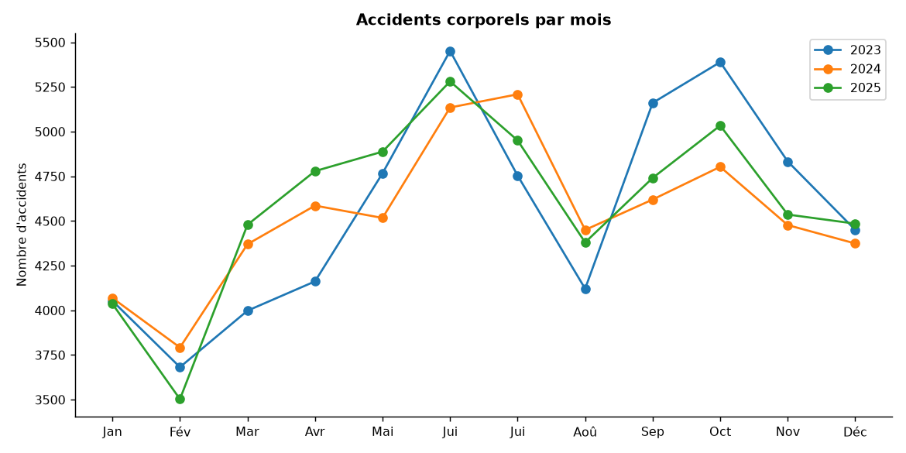
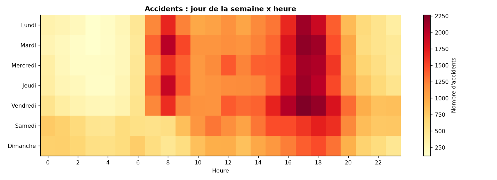
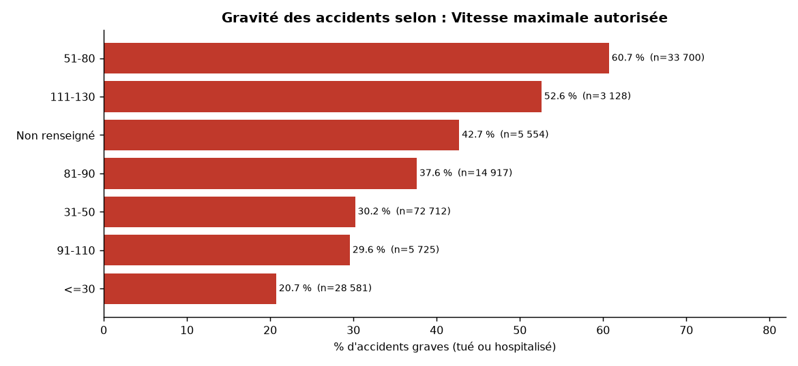
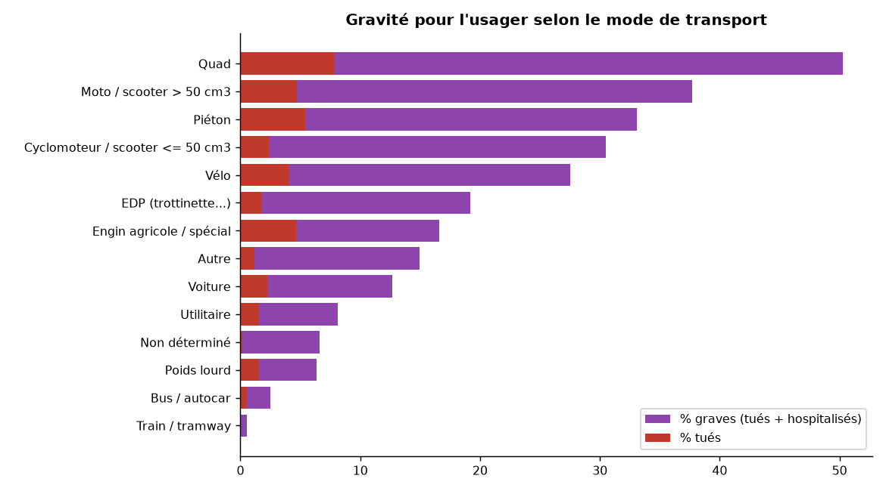

# Accidents corporels de la route en France (2023–2025)

**Data Challenge — Master Audit-Expertise, Brest Business School (module Progiciel)**

Analyse des accidents corporels de la circulation routière en France à partir de la base **BAAC** (Bulletins d'Analyse des Accidents Corporels) publiée par l'ONISR / ministère de l'Intérieur sur data.gouv.fr : un pipeline Python de qualité et de nettoyage des données, puis un tableau de bord interactif.

### 👉 [Ouvrir le tableau de bord interactif](https://elhajifi.github.io/accidents-route-france/)

> *English summary:* a data-quality pipeline (Python/pandas) and an interactive dashboard built on France's official road-accident database (BAAC) for 2023–2025 — 164,317 injury accidents, 377,352 people involved.

---

## Chiffres clés

| Indicateur | 2023 | 2024 | 2025 | Total |
|---|---:|---:|---:|---:|
| Accidents corporels | 54 822 | 54 402 | 55 093 | **164 317** |
| Usagers impliqués | 125 789 | 125 187 | 126 376 | **377 352** |
| Tués | 3 398 | 3 432 | 3 515 | **10 345** |
| Blessés hospitalisés | 19 271 | 19 126 | 19 601 | **57 998** |
| Part d'accidents graves (%) | 36,1 | 36,1 | 36,8 | 36,3 |
| Tués pour 100 accidents | 6,20 | 6,31 | 6,38 | 6,30 |

## Le tableau de bord

`index.html` est une page autonome (aucune installation requise) :

- **filtrage croisé** : un clic sur une barre filtre tout le tableau de bord, un second clic retire le filtre ;
- trois mesures au choix : nombre d'accidents, part d'accidents graves, tués pour 100 accidents ;
- **carte** de la métropole : glisser un rectangle pour filtrer sur une zone ;
- les barres reposant sur moins de 50 accidents sont estompées pour signaler leur fragilité statistique.

Un accident est classé selon son usager le plus gravement atteint : léger, grave (au moins un blessé hospitalisé) ou mortel (au moins un tué).

## Le pipeline de données

`pipeline_baac.py` enchaîne les étapes suivantes sur les 12 fichiers bruts (4 tables × 3 années) :

1. **Exploration** — volumes, profil des colonnes, cardinalités, couverture temporelle
2. **Diagnostic qualité** — doublons, valeurs manquantes codées (`-1`, `N/A`, `#VALEURMULTI`), lignes orphelines, coordonnées GPS hors de l'emprise du département…
3. **Nettoyage** — chaque correction est tracée dans un journal (ex. inversions latitude/longitude corrigées automatiquement)
4. **Transformation** — libellés issus du référentiel BAAC, gravité par accident, tranches horaires, saisons, jours fériés, classes d'âge
5. **Indicateurs** — KPI par année, temps, territoire, conditions (lumière, météo, surface, type de route, vitesse maximale autorisée…) et figures

### Lancer le pipeline

```bash
pip install -r requirements.txt
python pipeline_baac.py --entree donnees_brutes --sortie sortie_baac
```

Option : `--annees 2023 2024` pour ne traiter que certaines années.

## Organisation du dépôt

```
├── index.html                  Tableau de bord interactif (publié via GitHub Pages)
├── pipeline_baac.py            Pipeline exploration → qualité → nettoyage → indicateurs
├── requirements.txt
├── donnees_brutes/             CSV BAAC bruts : caract, lieux, usagers, vehicules × 2023-2025
├── docs/                       Description officielle des variables BAAC (PDF)
└── sortie_baac/
    ├── rapports/               01_exploration · 02_diagnostic_qualite · 03_journal_nettoyage · 04_indicateurs (.xlsx)
    ├── figures/                12 graphiques PNG
    └── donnees_propres/        (non versionné) accidents, usagers, vehicules nettoyés
```

Les données nettoyées (`sortie_baac/donnees_propres/`) ne sont pas incluses car `usagers.csv` dépasse la limite de 100 Mo de GitHub ; elles se régénèrent en lançant le pipeline.

## Aperçu

| | |
|---|---|
|  |  |
|  |  |

## Source des données

Base de données annuelles des accidents corporels de la circulation routière — ONISR, ministère de l'Intérieur, publiée sur [data.gouv.fr](https://www.data.gouv.fr/) sous Licence Ouverte. Les effectifs sont des nombres bruts, non rapportés à la population ni au trafic.

## Outils

Python · pandas · NumPy · Matplotlib · openpyxl · HTML/CSS/JavaScript
